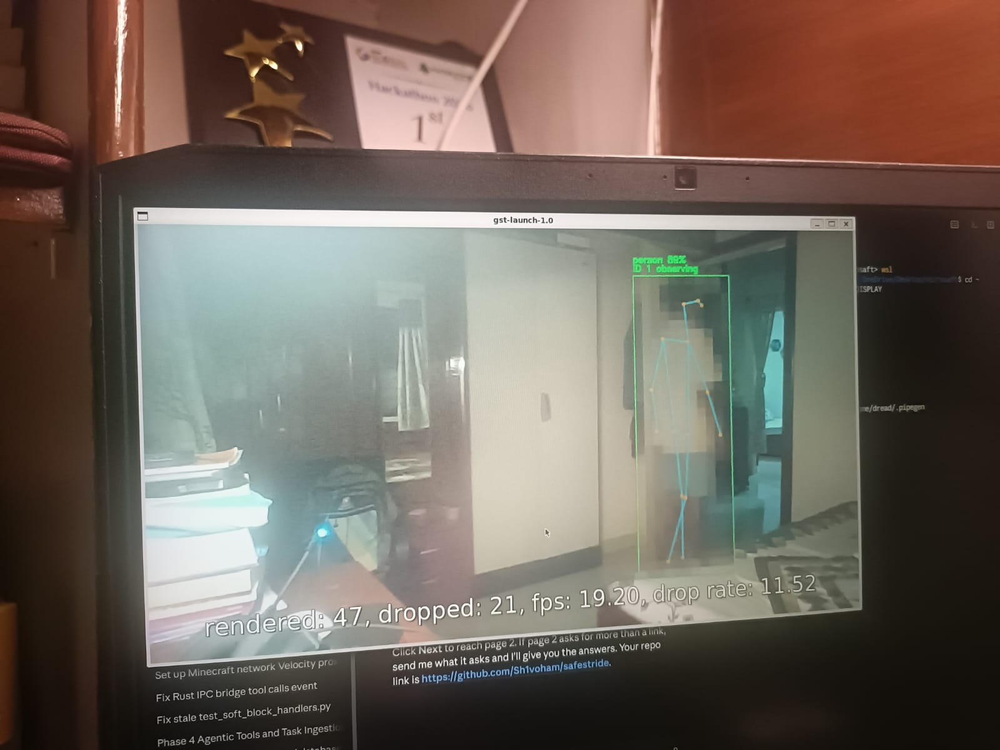
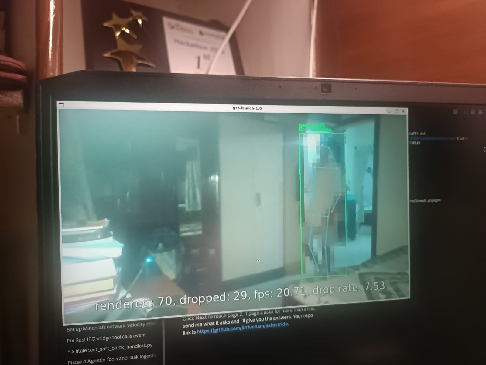
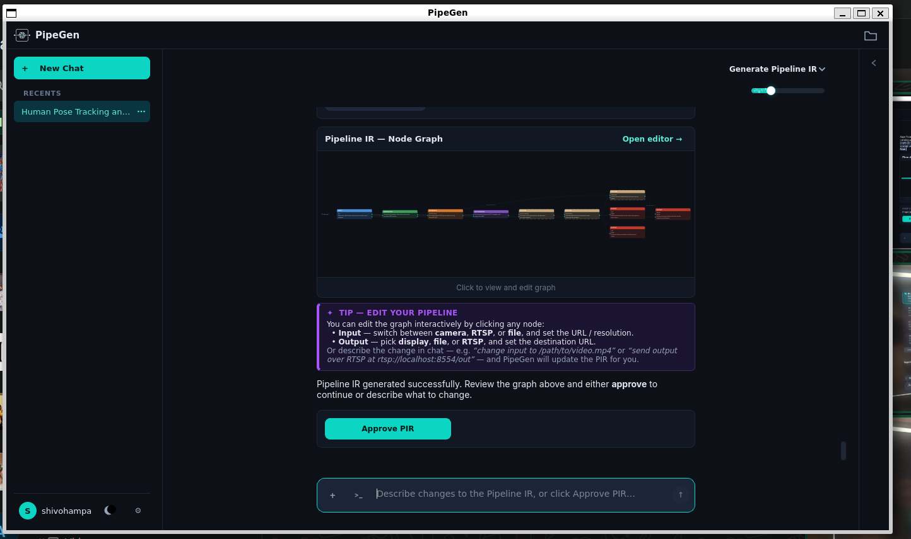
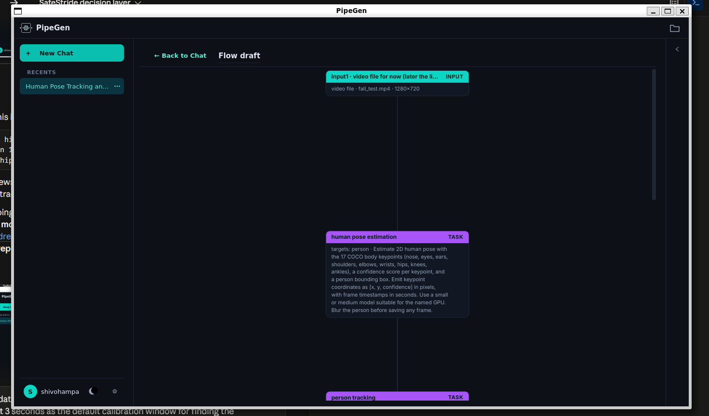
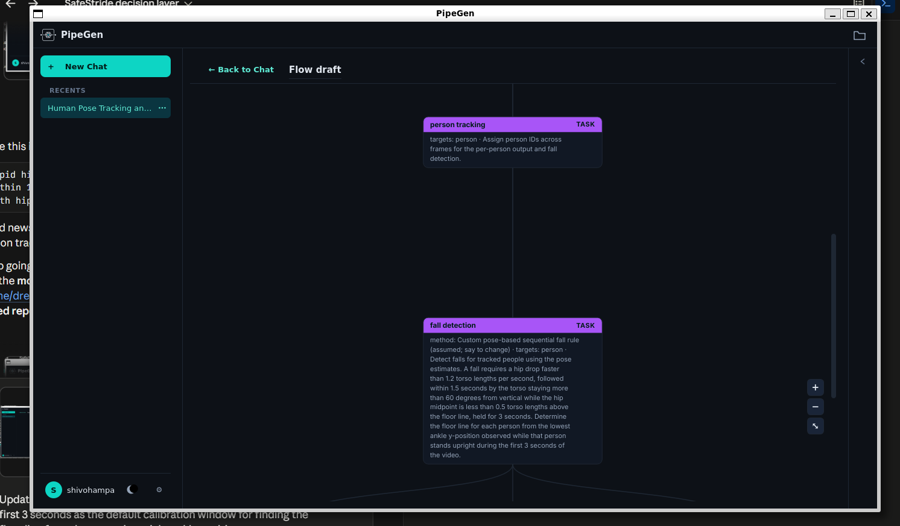
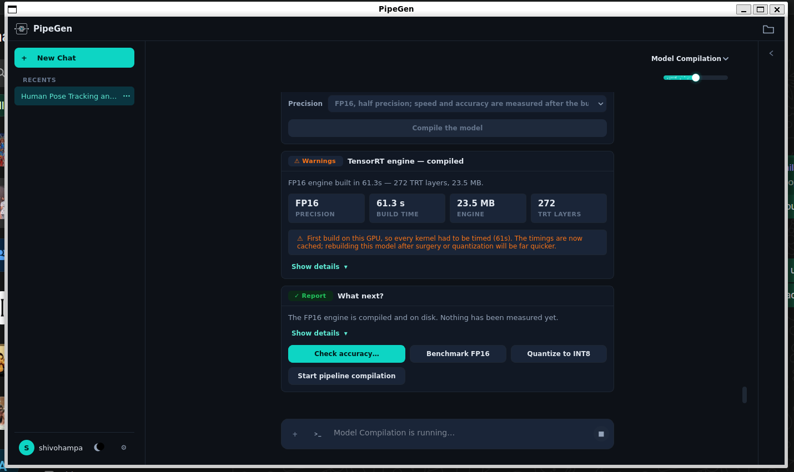
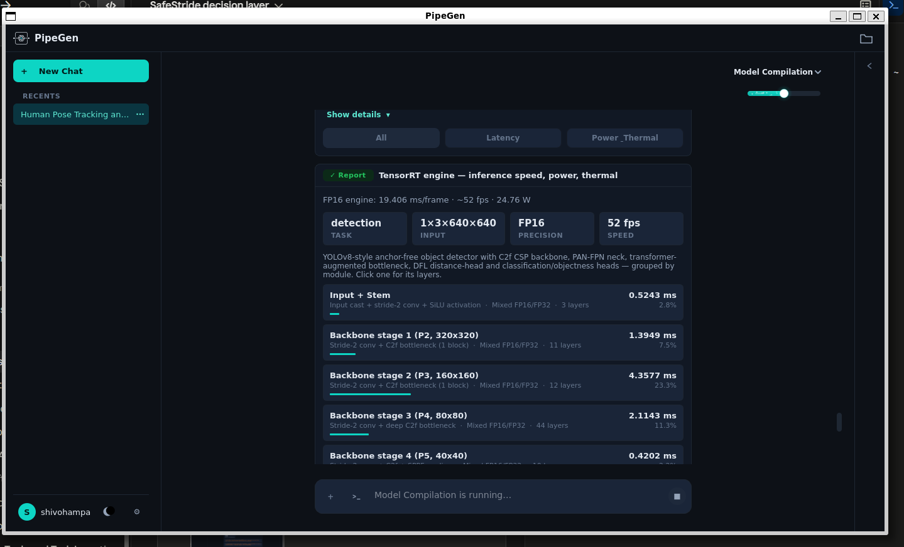
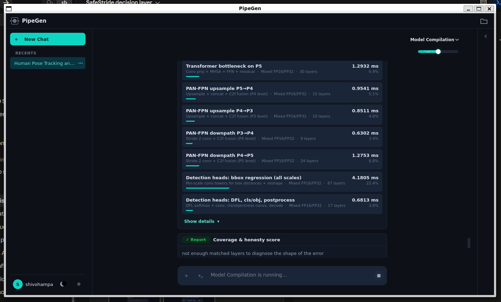
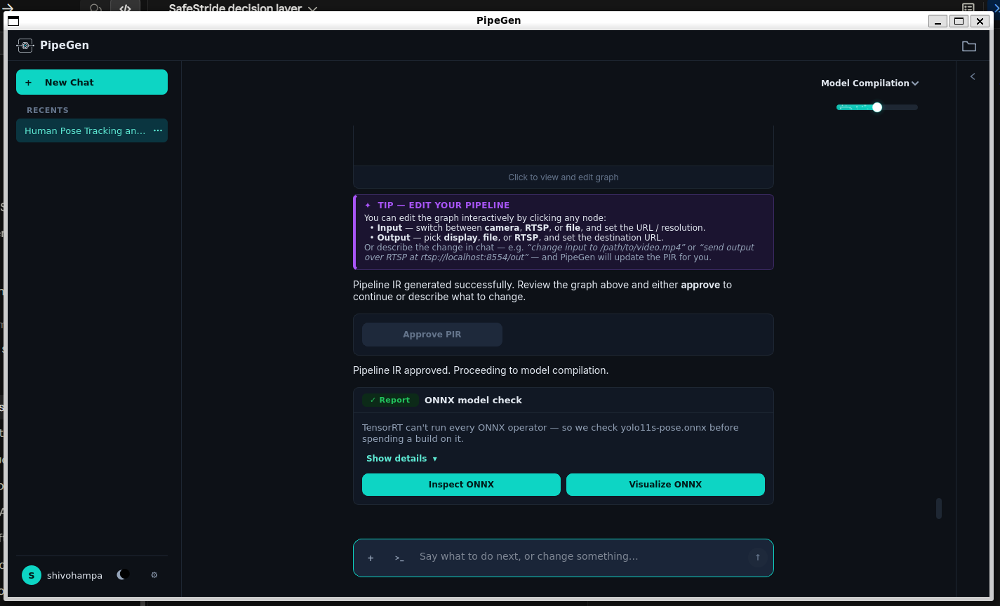
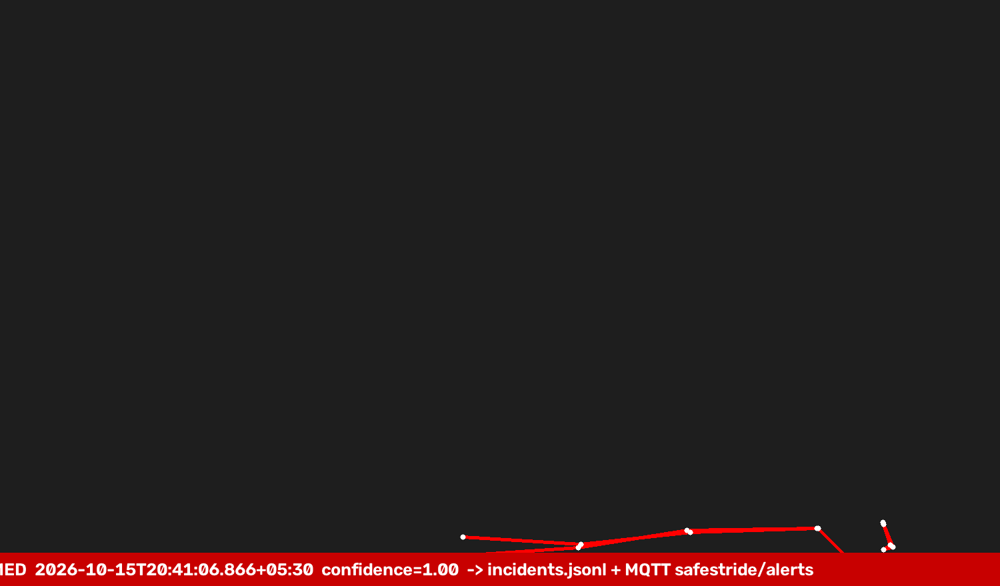

# SafeStride

> **Note on the repository name:** `CRA010` is a **placeholder** participant ID. We were not sent a participant ID, and the organizers told us none was needed, but the submission form requires the `CraftifAIHackathon_<ID>` format.

SafeStride does fall detection and gait-based fall-risk screening from one camera, on an edge GPU. It is built for the Embedded SF × CraftifAI hackathon (Problem #2, Track A).

The perception pipeline is built, compiled and run in **CraftifAI PipeGen**: video → yolo11s-pose (17 COCO keypoints) → person tracking → fall detection → JSON metadata + live display, with a TensorRT FP16 engine. The `logic/` package then turns the keypoints into:
- fall alerts (a JSON incident log and MQTT);
- gait metrics;
- a LOW / MODERATE / HIGH fall-risk band.

SafeStride is a screening aid, not a medical device.

## Demo video

[docs/demo_video.mp4](docs/demo_video.mp4) (78 s): the PipeGen build, the TensorRT report, the live run, then the decision layer raising a fall alert and showing the risk band. It was rebuilt from our screenshots and replay with `python docs/make_demo_video.py`.

## Running live (PipeGen DeepStream app on the GTX 1650)

The pipeline runs on our recorded clip. It draws the yolo11s-pose skeleton, the person box and the tracker ID ("ID 1 observing"), with the **person blurred** (privacy), at about 19–20 FPS on screen:




Every step of the PipeGen build (requirement, inputs, flow, model, Pipeline IR, TensorRT reports, run) is in [`screenshots/`](screenshots/), numbered in order.

## PipeGen pipeline (Pipeline IR node graph)



Flow draft (input → pose estimation → tracking → fall detection):




## TensorRT engine (PipeGen Model stage)

Model: **yolo11s-pose** from the PipeGen catalog, compiled to a **TensorRT FP16** engine. On an **NVIDIA GeForce GTX 1650 (4 GB)**, PipeGen's speed report gives:
- 23.5 MB engine, 272 layers, built in 61.3 s;
- **19.4 ms/frame, about 52 FPS, 24.8 W**, at a 640×640 input.






## SafeStride decision layer running

A fall replayed through the decision layer: the hips drop fast, then the person stays down for 3 s. The result is `FALL_CONFIRMED`, written to `incidents.jsonl` and published on MQTT `safestride/alerts`.



Example incident log line (`docs/sample_incidents.jsonl`):

```json
{"ts": "2026-10-15T20:41:07.563+05:30", "event": "FALL_CONFIRMED", "confidence": 0.996, "torso_angle_deg": 89.3, "hip_drop_speed_Lps": 4.15, "time_down_s": 3.03, "camera": "builtin0", "model": "pose-fp16", "frame_saved": null, "t_s": 7.563}
```

## How to run

**1. The PipeGen pipeline.** The exported project is in [`pipegen_project/`](pipegen_project/). It contains the Pipeline IR, the generated DeepStream app in `src1/WorkerFallDetection/`, the ONNX model and the FP16 `.plan` engine. Inside PipeGen (v0.5.1, Ubuntu or WSL2 with an NVIDIA GPU), the generated app runs with:

```bash
python application.py /home/dread/videos/fall_test.mp4
```

Set the pipeline's per-frame keypoint JSON output to a file, for example `/home/dread/pipegen_out/keypoints.jsonl`.

**2. The SafeStride decision layer** reads the pipeline's keypoint JSON:

```bash
pip install -r logic/requirements.txt
python -m pytest logic/tests -q                       # 175 tests
python -m logic.demo --selftest                       # end-to-end self test
python -m logic.demo --source tail:/home/dread/pipegen_out/keypoints.jsonl --log-level INFO   # live, follows PipeGen output
python -m logic.demo --source file:docs/demo_fall.jsonl --realtime --overlay                  # replay demo
mosquitto_sub -h localhost -t "safestride/#" -v       # watch the alerts
```

## Documents

- `logic/README.md`: every command (PowerShell and bash).
- `docs/ARCHITECTURE.md`: data flow, modules, data contract.
- `docs/PROJECT_DESCRIPTION.md`: project description.
- `docs/RESULTS.md`: measured results, generated by `python -m logic.make_results`.
- `docs/DEMO_SCRIPT.md`: the two-minute demo and the fallback plan.
- `NOTES.md`: decisions, parameter values, limitations.
